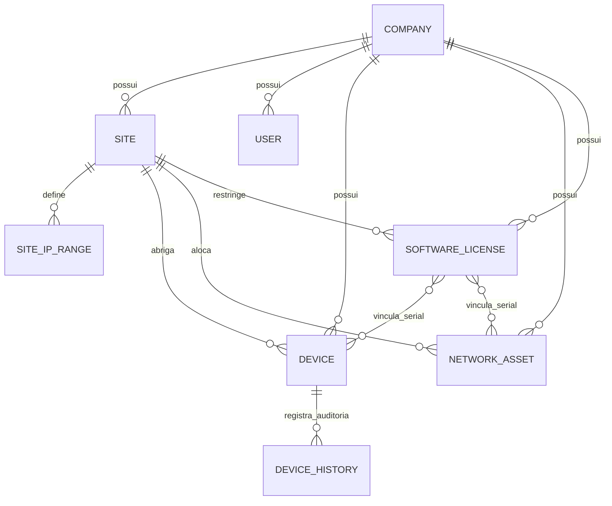
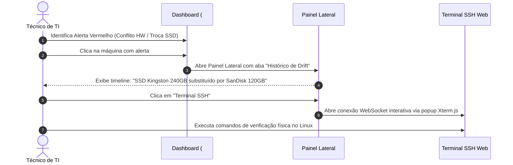
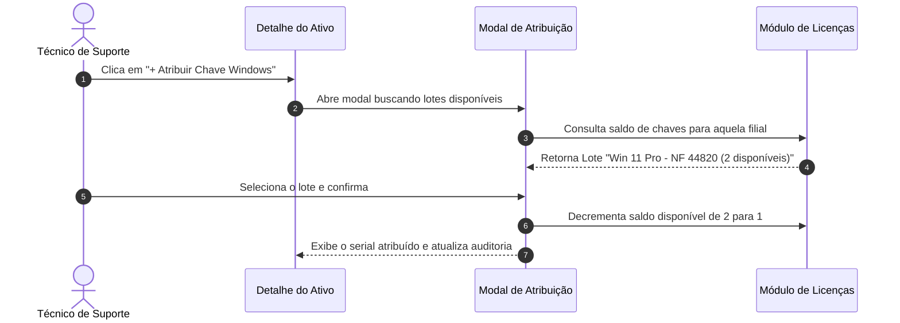

# FRONTEND REDESIGN BRIEF & UI/UX AUDIT SPECIFICATION
**Projeto:** ZenithMap Asset & Network Intelligence & Fleet RMM  
**Documento:** Especificação Técnica de Produto, Auditoria de UI/UX e Briefing para Redesign (UX Pilot)  
**Versão:** 1.0.0  
**Perfil do Documento:** Documentação autossuficiente para reprodução e redesign por IA de UI/UX  

---

## 1. RESUMO EXECUTIVO

### 1.1 Contexto e Missão do Produto
O **ZenithMap Asset & Network Intelligence** é uma plataforma corporativa web de **RMM (Remote Monitoring & Management), Descoberta de Ativos e Inventário de Hardware/Software**, desenvolvida para sustentar a operação de TI do ZenithMap (rede com dezenas de unidades operacionais entre Unidades e Filiais, atacados Combo e departamentos da Matriz Administrativa em Santa Catarina).

O produto atua como uma **torre de controle operacional unificada** para a equipe de infraestrutura e suporte de TI, centralizando:
1. **Telemetria de Estações de Trabalho:** Coleta periódica de agentes locais (Linux e Windows), abrangendo saúde de SSD/HD, ocupação de disco particionado, inventário de hardware (CPU, RAM, placa-mãe, monitor, periféricos USB), alertas de drift de componentes e conformidade no Firewall.
2. **Ativos de Rede & Faixas de IP (IoT):** Gerenciamento e varredura ICMP de impressoras térmicas, balanças de checkout, access points, switches, cancelas, totens e coletores, integrando controle de ocupação de VLANs e provisionamento de IPs livres por loja.
3. **Acesso Remoto Operacional Híbrido:** Integração embutida com MeshCentral (WebRTC/VNC para Desktop, Gerenciador de Arquivos SFTP e Shell) e RustDesk, além de terminal SSH nativo via WebSockets (Xterm.js).
4. **Governança de Licenças e Softwares:** Controle rigoroso de chaves/seriais de Windows e pacotes Microsoft Office / 365 com gestão de lotes por Nota Fiscal e saldo dinâmico de cotas sincronizado às estações.
5. **Auditoria de Conformidade e Drift de Aplicativos:** Detecção de versões desatualizadas de navegadores e softwares corporativos distribuídos na frota.
6. **Autenticação Corporativa & Active Directory:** Integração LDAP direta, mapeamento hierárquico de grupos do AD para filiais e perfis com suporte a 2FA (TOTP).

### 1.2 Diagnóstico Crítico do Frontend Atual
Embora o sistema apresente alta completude funcional e estabilidade operacional, a interface evoluiu de forma orgânica sobre uma inspiração inicial de consoles de monitoramento como NinjaOne e Octofleet. O resultado acumulado é uma interface com **alta fadiga cognitiva**:
- **Densidade Visual Heterogênea:** Existem telas com densidade de planilha comprimida (como Ativos de Rede e Licenças) convivendo com dashboards repletos de cartões e gráficos circulares decorativos (Inventário de Estações), gerando descompasso de ritmo.
- **Saturação de Badges e Cores Arbitrárias:** Uso disperso de badges fluorescentes (azul ciano, roxo neon, laranja forte, verde e vermelho) competindo pela atenção primária do operador, tornando alertas reais de conflito de hardware difíceis de distinguir de status operacionais rotineiros.
- **Poluição em Linhas e Gavetas (Drawers):** As tabelas principais utilizam linhas sanfonadas (drawers colapsáveis) que abrigam até 6 seções verticais com múltiplos cartões internos, botões minúsculos de copiar e tags soltas, exigindo rolagem extensa dentro de uma única linha de tabela.
- **Formulários e Modais Sobrecarregados:** Modais com larguras fixas rígidas, scroll duplo em telas menores e ausência de uma escala dimensional padronizada de controles (botões e selects oscilando entre 32px e 42px).

### 1.3 Propósito Deste Documento
Este briefing traduz todas as regras de negócio, dados, fluxos e restrições reais mapeadas no código-fonte em especificações canônicas para permitir que ferramentas de IA de design (como UX Pilot, v0 ou Figma AI) projetem uma **identidade visual corporativa própria, austera, fluida e orientada à alta produtividade técnica**.

---

## 2. DESCRIÇÃO DO PRODUTO E ESCOPO ANALISADO

### 2.1 Finalidade e Problemas Resolvidos
| Problema no Chão de Operação | Solução no Sistema ZenithMap |
| :--- | :--- |
| Falta de visibilidade da integridade física de milhares de PDVs e caixas de supermercado. | Telemetria automatizada que audita RAM, disco e alerta instantaneamente sobre substituição não autorizada ou quebra física de hardware (Hardware Drift). |
| Conflito de IPs e dificuldade em identificar endereços livres para novos equipamentos de loja. | Mapeamento automático de faixas de IP por filial, calculando dinamicamente IPs livres e permitindo provisionamento com 1 clique. |
| Incerteza jurídica e operacional sobre o estoque de licenças de Windows e Office. | Registro digital de licenças vinculado a Notas Fiscais e decremento dinâmico conforme as máquinas são ativadas na rede. |
| Múltiplas ferramentas fragmentadas para suporte remoto (AnyDesk, SSH, Putty, MeshCentral). | Console centralizado onde o técnico clica em Desktop, Terminal, Arquivos ou SSH direto no navegador. |
| Dificuldade em restringir acessos de técnicos de filiais específicas. | Mapeamento de grupos do Active Directory que restringe automaticamente a visualização apenas às lojas sob responsabilidade daquele operador. |

### 2.2 Perfis de Usuários Identificados no Código
1. **Super Administrador (`is_superadmin = true`):**
   - Acesso irrestrito a todas as filiais, configurações do Active Directory, gerenciamento de lojas, exclusão em massa, auditoria global e SSH irrestrito.
2. **Administrador de Loja / Geral (`role: 'admin'`):**
   - Gestão de ativos de rede, faixas de IP, configurações de lojas, importação de CSV, cadastro e expansão de licenças, instalação de agentes e terminal SSH.
3. **Operador Matriz (`role: 'operador_matriz'`):**
   - Acesso transversal a todas as lojas para monitoramento, acesso remoto e solicitação/homologação de máquinas no Firewall corporativo, porém com restrições a configurações críticas do Active Directory e console de servidor.
4. **Operador de Loja / Técnico Local (`role: 'operator'`):**
   - Acesso estritamente restrito às estações e ativos pertencentes às filiais associadas ao seu usuário/grupo LDAP. Não possui permissão para executar comandos via Terminal SSH, excluir ativos ou alterar parametrizações de rede.

### 2.3 Entidades Principais e Relações


---

## 3. STACK TÉCNICA E ESTRUTURA DO FRONTEND

### 3.1 Tecnologias e Dependências Reais
- **Core:** React 19.2.8, React DOM 19.2.8.
- **Tipagem & Compilação:** TypeScript 6.0.2, Vite 8.3.0.
- **Linter & Validação:** Oxlint 1.81.0.
- **Terminal Web SSH:** `@xterm/xterm` 6.0.0 com plugin oficial `@xterm/addon-fit` 0.11.0.
- **Segurança de Sub-recurso:** `vite-plugin-sri` 0.0.2.
- **Estilos:** Vanilla CSS com tokens estruturados em variáveis CSS Custom Properties (`theme.css` e `theme-overrides.css`).
- **Comunicação:** Fetch API nativa consumindo backend REST FastAPI + WebSockets para SSH interativo.
- **Roteamento:** Hash Router manual sincronizado a `window.location.hash` (`#inv`, `#net`, `#remote`, `#rel`, `#apps`, `#sites`, `#licenses`, `#ad`, `#terminal?id=X`). Não utiliza bibliotecas pesadas de roteamento como React Router.

### 3.2 Estrutura de Arquivos do Frontend
```
frontend/src/
├── App.tsx                     # Orquestrador global, roteamento por hash, autenticação e modais
├── main.tsx                    # Ponto de montagem React DOM
├── assets/                     # Logotipo institucional e recursos visuais
├── components/                 # Componentes compartilhados
│   ├── Header.tsx              # Barra superior enterprise com status ao vivo e switcher de tema
│   ├── Sidebar.tsx             # Menu lateral retrátil com badge de contagem de estações
│   ├── SiteSelect.tsx          # Seletor hierárquico avançado de lojas (Lojas, Combos, Matriz)
│   ├── DonutChart.tsx          # Gráfico de rosca SVG interativo para drilldown
│   ├── Icons.tsx               # Biblioteca interna de SVGs vetoriais puros
│   ├── SshTerminalModal.tsx    # Terminal web interativo Xterm.js
│   ├── AgentInstallModal.tsx   # Modal de scripts de instalação (PowerShell / Bash)
│   ├── DeleteDeviceModal.tsx   # Confirmação destrutiva de máquina
│   └── ActiveDirectorySettings.tsx # Painel completo de governança LDAP
├── pages/                      # Telas da aplicação
│   ├── Login.tsx               # Login multi-etapa com suporte a 2FA TOTP e AD
│   ├── InventoryPage.tsx       # Dashboard e tabela principal de Estações de Trabalho
│   ├── NetworkAssetsPage.tsx   # Ativos de Rede, Varredura ICMP e IPs Livres
│   ├── RemoteAccessPage.tsx    # Grid de Acesso Remoto MeshCentral / RustDesk
│   ├── ReportsPage.tsx         # Relatórios agregados de hardware e conformidade
│   ├── AppsPage.tsx            # Auditoria de versões de navegadores e softwares
│   ├── SitesPage.tsx           # Cadastro de Lojas, Faixas de IP e Classificador
│   ├── LicensesPage.tsx        # Controle de Seriais Windows e Office por Nota Fiscal
│   └── ActiveDirectoryPage.tsx # Envoltório para ActiveDirectorySettings
└── styles/                     # Folhas de estilo modularizadas por tela e componente
```

---

## 4. INVENTÁRIO COMPLETO DE ROTAS, TELAS E MÓDULOS

### 4.1 Tela 01: Autenticação, Desafio 2FA e Configuração Inicial (`Login.tsx`)
- **Rota / URL:** Rota raiz quando não autenticado (`token` ausente no `localStorage`).
- **Módulo:** Identidade & Acesso.
- **Finalidade:** Autenticar operadores de loja e administradores contra banco local ou Active Directory, executando desafio ou provisionamento de segundo fator (2FA TOTP).
- **Sub-etapas Identificadas:**
  1. *Step 1 (`credentials`):* Formulário de Usuário, Senha (com toggle de revelar e alerta visual de Caps Lock), checkbox "Lembrar usuário" e submissão.
  2. *Step 2 (`challenge_2fa`):* Se o usuário já possui 2FA ativo, exibe campo numérico de 6 dígitos para o código TOTP do aplicativo autenticador.
  3. *Step 3 (`setup_2fa`):* Se for o primeiro acesso de usuário administrativo/matriz, renderiza o QR Code SVG da URI OTPAuth e exibe a chave secreta alfanumérica com botão de cópia rápida.
- **Feedbacks & Estados:** Alerta de erro com tradução para falhas de rede, botão com spinner de carregamento, atalho para voltar do 2FA para credenciais.

### 4.2 Tela 02: Dashboard e Inventário de Estações de Trabalho (`#inv` - `InventoryPage.tsx`)
- **Rota / URL:** `#inv` (visualização padrão do sistema).
- **Módulo:** Estações de Trabalho & Gestão de Parque.
- **Finalidade:** Monitorar o parque de computadores da empresa, verificar conformidade de sistema, auditar espaço em disco, detectar hardware drift e homologar máquinas no Firewall.
- **Blocos de Informação:**
  1. *Painel de Gráficos de Rosca Interativos (Donut Charts):*
     - Distribuição por SO (Linux Zorin, Ubuntu, Windows 10, Windows 11).
     - Status de conformidade (Atualizada vs Atualização Necessária).
     - Tipo de Unidade (Lojas, Combos, Matriz).
     - *Interatividade:* Clicar em qualquer fatia ou legenda aplica filtro bidirecional instantâneo na tabela abaixo.
  2. *Cards de KPIs Clicáveis:*
     - Máquinas Linux (total filtrado x cadastrado).
     - Máquinas Windows (total filtrado x cadastrado).
     - Alertas de Hardware / Conflitos de MAC (destaque crítico vermelho quando > 0).
     - Máquinas Inativas (> 48h sem telemetria).
     - Pendências de Firewall (contador de solicitações aguardando homologação).
  3. *Barra de Filtros Combinados:* Busca textual por Hostname/IP/MAC/Patrimônio/Usuário, Dropdown hierárquico de Loja, Plataforma (Win/Linux), Versão exata do SO, Status de Atualização, Alerta de Disco Crítico (<10% ou <20%), Botão de Limpar e Botão "Exportar CSV".
  4. *Tabela de Estações de Trabalho:*
     - Colunas: Status (Online/Offline/Mesh), Filial, Hostname, IP Principal (com IPs extras colapsados), MAC, Ocupação de Disco (% e barra visual colorida), Sistema Operacional, Status de Upgrade e Coluna de Ações Rápidas.
  5. *Gaveta de Detalhes da Máquina (Expanded Row Detail):*
     - *Especificações:* Processador, Memória RAM (total e tipo DDR), Fabricante da Placa-mãe, Modelo, Serial do Chassi, Usuário logado.
     - *Armazenamento:* Lista particionada de unidades (`/`, `/var`, `C:`, `D:`) com breakdown de `/var/log` e diretórios dos principais usuários.
     - *Periféricos Conectados:* Monitores (resolução, serial, fabricante), impressoras USB, leitores, teclados e mouses.
     - *Rede & Firewall:* Situação de liberação no Firewall corporativo, botão para operador solicitar liberação e botão para admin confirmar homologação.
     - *Licenciamento:* Exibição de chaves de ativação de Windows e Office vinculadas.
     - *Histórico de Alterações de Hardware:* Timeline cronológica registrando substituição de peças (ex: aumento de memória, troca de HD por SSD, alteração de placa de rede).
     - *Ações Operacionais da Linha:* Input de edição direta de patrimônio, atalho para Terminal SSH web, cópia de RustDesk ID e exclusão de máquina.

### 4.3 Tela 03: Ativos de Rede, Varredura ICMP & IPs Livres (`#net` - `NetworkAssetsPage.tsx`)
- **Rota / URL:** `#net`.
- **Módulo:** Ativos de Rede, IoT & Gestão de IPs.
- **Finalidade:** Controlar todos os equipamentos de rede que não rodam agente (impressoras térmicas, balanças, switches, roteadores, relógios ponto, cancelas) e calcular ocupação de VLANs.
- **Blocos de Informação:**
  1. *Header de Métricas de Rede:* Total de Ativos, Impressoras, Equipamentos de Rede (Switches/Roteadores), Access Points WiFi, Dispositivos Online e Dispositivos Offline.
  2. *Filtros de Rede:* Seletor de Loja (`SiteSelect`), Seletor de Faixa de IP/VLAN cadastrada, Filtro de Ocupação (Ocupados, Livres, Estações integradas, Ativos manuais), Filtro de Grupo de Equipamento e Busca por Colunas individuais.
  3. *Tabela Híbrida de Ativos & IPs Livres:*
     - As estações de trabalho e os ativos de rede manuais ocupam IPs na lista.
     - Os endereços não utilizados dentro da faixa configurada daquela loja aparecem como linhas de **"IP Livre"** identificadas com tag azul.
     - Ações por linha: Ping individual em tempo real com retorno de latência (ms), Duplicação inline direta (cria linha editável na tabela para cadastro rápido), Edição modal, Exclusão e botão "+ Usar IP" na linha livre.
  4. *Gaveta de Detalhes da Linha (Network Drawer):*
     - Sistema & Licenças com botões interativos para vincular chave de ativação ou desvincular.
     - Dados de fabricante, modelo, porta de switch, VLAN e notas de infraestrutura.
  5. *Modais do Módulo:*
     - Modal de Cadastro/Edição de Ativo (com validação anti-conflito de IP e campos de licença).
     - Modal de Importação de Planilha CSV (com sincronização inteligente de patrimônio em computadores protegidos).
     - Modal de Confirmação de Varredura em Lote (Scan Ping ICMP concorrente).
     - Modal de Exclusão em Massa (Bulk Delete).
     - Modal de Atribuição Rápida de Licença por saldo de lotes.

### 4.4 Tela 04: Central de Acesso Remoto Operacional (`#remote` - `RemoteAccessPage.tsx`)
- **Rota / URL:** `#remote`.
- **Módulo:** Operações Remotas & Suporte Técnico.
- **Finalidade:** Permitir que técnicos conectem-se instantaneamente a qualquer máquina da frota via interface gráfica, navegador de arquivos, linha de comando ou RustDesk.
- **Blocos de Informação:**
  1. *Barra de Busca e Filtros Rápidos:* Busca por Hostname, IP, Usuário ou Loja; filtro de SO (Windows/Linux); filtro de conectividade (Online/Offline) e paginação ajustável (12, 24, 48 cards).
  2. *Grid de Máquinas Prontas para Acesso:* Cards ergonômicos exibindo hostname, status de ping, usuário logado, versão do SO e ações de acesso:
     - Botão Desktop Remoto (WebRTC / VNC).
     - Botão Gerenciador de Arquivos (SFTP).
     - Botão Terminal de Linha de Comando (Shell MeshCentral).
     - Botão Terminal SSH Direto.
     - Exibição de RustDesk ID com botão de cópia rápida.
  3. *Modal de Sessão Remota Embutida:* Iframe protegido com abas no cabeçalho para alternar dinamicamente entre *Área de Trabalho*, *Arquivos* e *Terminal* sem reiniciar a conexão, além de botão de tela cheia e botão para abrir em nova aba do navegador.

### 4.5 Tela 05: Relatórios de Upgrade & Diagnóstico de Frota (`#rel` - `ReportsPage.tsx`)
- **Rota / URL:** `#rel`.
- **Módulo:** Inteligência de Parque & Planejamento de Hardware.
- **Finalidade:** Agregar o inventário por qualquer atributo de hardware para subsidiar decisões de compras e trocas de componentes.
- **Blocos de Informação:**
  1. *Filtros de Segmentação:* Seleção do campo agrupador (Processador, Memória RAM, Fabricante, Modelo, Placa-mãe, Sistema Operacional, Tamanho de Disco, Domínio), seletor de filial e seletor de plataforma.
  2. *Painel de Distribuição Visual (Barras Horizontais):* Lista dos modelos/capacidades encontrados, com barras de preenchimento proporcional à frota e contagem absoluta.
  3. *Drilldown de Máquinas:* Ao clicar em um modelo específico de processador ou tamanho de RAM, a tabela inferior filtra imediatamente todas as máquinas que possuem aquela configuração, com link direto para visualizá-las no inventário e botão "Exportar Relatório CSV".

### 4.6 Tela 06: Inventário de Softwares & Auditoria de Versão (`#apps` - `AppsPage.tsx`)
- **Rota / URL:** `#apps`.
- **Módulo:** Governança de Software & Cibersegurança.
- **Finalidade:** Auditar todos os pacotes e softwares instalados, apontando desvios de versão e navegadores obsoletos.
- **Blocos de Informação:**
  1. *Painel de Conformidade de Navegadores:* Cards de saúde para Google Chrome, Microsoft Edge e Mozilla Firefox, exibindo a versão mais recente em uso na empresa, percentual de conformidade e contagem de estações desatualizadas.
  2. *Navegação por Categorias:* Navegadores, Agentes de Monitoramento (Mesh, Zabbix, RustDesk), Runtimes (Java, .NET, Node, Python), Ferramentas e Utilitários, Aplicativos Gerais.
  3. *Master-Detail de Aplicativos:*
     - Coluna Esquerda: Lista de programas com número de instalações e tag de conformidade.
     - Coluna Direita (Detalhes): Lista de máquinas que possuem o software, versão específica, tag de alerta (se for versão antiga), botão de Terminal SSH e atalho para o inventário.

### 4.7 Tela 07: Lojas, Filiais & Padrões de Nomenclatura (`#sites` - `SitesPage.tsx`)
- **Rota / URL:** `#sites`.
- **Módulo:** Estrutura Organizacional & Rede.
- **Finalidade:** Cadastrar unidades da rede (LJ01, LJ02, COMB01, Matriz), gerenciar faixas de IP associadas e parametrizar regras de identificação de hostname.
- **Blocos de Informação:**
  1. *Tabela de Filiais:* Código, Nome, Status Ativo/Inativo, Quantidade de Estações Atribuídas, Tags de Identificação (padrões de regex para classificar máquinas automaticamente pelo nome).
  2. *Submódulo de Faixas de IP / VLANs:* Tabela de faixas cadastradas por loja (IP início, IP fim, Gateway, Máscara), com cálculo automático de total de IPs, ocupados e livres.
  3. *Simulador de Classificação de Loja:* Modal interativo onde o técnico digita um hostname ou código para testar em tempo real qual loja o algoritmo atribuirá.
  4. *Reclassificação em Massa da Frota:* Execução de reanálise de todas as máquinas desatribuídas contra os padrões cadastrados, exibindo relatório de movimentações.

### 4.8 Tela 08: Gestão de Licenças & Seriais Corporativos (`#licenses` - `LicensesPage.tsx`)
- **Rota / URL:** `#licenses`.
- **Módulo:** Gestão de Ativos Intangíveis & Compliance de Software.
- **Finalidade:** Controlar estoque de chaves de Windows e pacotes Office, garantindo que nenhuma licença seja usada além da cota comprada.
- **Blocos de Informação:**
  1. *Cards de KPIs de Licença:* Total de Licenças Adquiridas, Licenças em Uso, Saldo Disponível e Total de Lotes Esgotados.
  2. *Planilha Digital de Lotes:* Tabela com filtros por Categoria (Windows, Office, Outros), Loja/Matriz, Status de Esgotamento e busca de texto.
  3. *Ações por Linha de Licença:* Máscara/revelação de chave, cópia rápida, contadores de uso dinâmico (`em_uso` x `disponivel`), badge visual de "ESGOTADA" e botão de histórico de computadores vinculados.
  4. *Modais do Módulo:*
     - Modal de Cadastro de Lote com sugestões predefinidas de versões corporativas (Win 11 Pro, Server 2022, Office 2021, M365 Apps), campo para Nota Fiscal (NF) e quantidade adquirida.
     - Modal de Rastreamento de Computadores vinculados à chave.

### 4.9 Tela 09: Configurações do Active Directory & Mapeamentos (`#ad` - `ActiveDirectorySettings.tsx`)
- **Rota / URL:** `#ad`.
- **Módulo:** Governança Corporativa de Identidade.
- **Finalidade:** Configurar autenticação LDAP, mapear grupos de rede para perfis e auditar acessos.
- **Blocos de Informação (Abas Internas):**
  1. *Aba Conexão:* Parâmetros de servidor (Host, Porta 389/636, SSL/TLS, Domínio, Base DN, Usuário de Consulta Bind, Senha oculta), botão de teste de conexão com indicador de latência em milissegundos e diagnóstico de erros.
  2. *Aba Permissões & Mapeamento de Lojas:* Definição de grupos de Superadministrador e mapeamento visual de grupos de segurança do AD para lojas específicas e perfis de permissão.
  3. *Aba Simulador LDAP:* Formulário para testar o login de qualquer operador de loja, inspecionando os grupos retornados pelo AD e o perfil que ele receberá no sistema.
  4. *Aba Usuários & 2FA:* Gestão de contas ativas, sincronização e botão de reset de 2FA em caso de perda de dispositivo.

### 4.10 Componentes Globais & Modais Transversais
1. **Terminal SSH Web (`SshTerminalModal.tsx`):**
   - Suporta modo embutido em modal ou modo **Standalone Popup** (`#terminal?id=X`) com redimensionamento automático de colunas/linhas via `@xterm/addon-fit`.
2. **Modal de Instalação de Agentes (`AgentInstallModal.tsx`):**
   - Comandos com 1 clique para Linux (Bash curl com download do serviço de telemetria) e Windows (PowerShell com token de provisionamento pré-configurado).
3. **Modal de Exclusão de Dispositivo (`DeleteDeviceModal.tsx`):**
   - Confirmação de segurança alertando sobre remoção de histórico de auditoria e liberação de patrimônio.
4. **Header Global (`Header.tsx`):**
   - Tag colorida do módulo atual, contador de pulso verde com timestamp da última telemetria, botão "Instalar Agente", botão de refresh de dados e toggle de tema Claro/Escuro.
5. **Sidebar Global (`Sidebar.tsx`):**
   - Logotipo ZenithMap, navegação por ícones com badges de contagem em tempo real, rodapé com avatar do usuário, nome, papel hierárquico e botão de encerramento seguro de sessão.

---

## 5. AUDITORIA CRÍTICA DE UI/UX DO DESIGN ATUAL

| Dimensão Avaliada | Problema Identificado no Código | Evidência Concreta | Impacto no Usuário | Prioridade | Recomendação de Redesign |
| :--- | :--- | :--- | :--- | :--- | :--- |
| **Identidade Visual** | Aparência de dashboard genérico "Dark Neon" que destoa da sobriedade corporativa do varejo. | Mistura de gradientes ciano/índigo (`#0284c7` para `#6366f1`) no logo com fundos `#090d16` e bordas com múltiplos níveis de opacidade. | Transmite sensação de painel amador ou template pré-fabricado de IA, sem personalidade sólida de produto de engenharia de TI. | **Alta** | Adotar uma linguagem austera de **Industrial Precision & Data Density**, com tons ardósia grafite, acentos azul-aço institucional e acabamento fosco sem brilhos artificiais. |
| **Composição & Espaço** | Tabelas com gavetas colapsáveis excessivamente longas que desestruturam a leitura contínua. | Linhas de detalhes expandidos (`na-row-detail`, `expandedDetails`) ocupando centenas de pixels de altura com até 6 sub-seções empilhadas. | O técnico perde o contexto da listagem ao expandir 2 ou 3 computadores, precisando rolar verticalmente dezenas de vezes. | **Alta** | Substituir o drawer empilhado na tabela por um **Slide-over Panel lateral (Sheet)** que se abre à direita, mantendo a listagem principal visível e interativa. |
| **Tipografia & Legibilidade** | Falta de escala tipográfica uniforme para metadados técnicos. | Uso de fontes variando entre `10px`, `10.5px`, `11px`, `11.5px`, `12px`, `12.5px`, `13px`, `13.5px` espalhadas pelos arquivos CSS. | Gera micro-desalinhamentos, cansaço visual e sensação de desordem visual ao comparar colunas adjacentes. | **Média** | Padronizar rigorosamente uma escala modular de 5 níveis: Micro (`11px`), Caption (`12px`), Body (`13px`), Subhead (`15px`) e Title (`18px`), com `JetBrains Mono` para dados técnicos. |
| **Componentes de Dados** | Proliferação desordenada de badges, tags coloridas e botões de ação repetidos. | Cada célula de IP, MAC e Hostname possui um mini-botão de cópia individual (`copy-button`) com animações próprias e bordas soltas. | Poluição visual extrema na tabela principal; em telas de 50 itens por página, há centenas de pequenos ícones concorrendo visualmente. | **Alta** | Adotar padrão **"Hover-to-Reveal"** para ações de cópia e unificar tags de rede em elementos compactos com feedback sutil em tooltip. |
| **Hierarquia Visual** | Gráficos de rosca (Donut) ocupam espaço vertical nobre no topo da tela de inventário, empurrando os dados essenciais para baixo. | 3 painéis de Donut Chart com altura de ~240px cada, antes mesmo da barra de filtros e da tabela de máquinas. | Obriga o técnico a rolar a página para baixo a cada carregamento para ver o que realmente importa (a lista de máquinas). | **Média** | Reorganizar o topo em uma **Barra de Indicadores Compactos (KPI Strip)** com mini-barras de progresso inline e recolher gráficos detalhados em visão colapsável. |
| **Formulários & Modais** | Modais com rolagem interna oculta e desalinhamento de botões de rodapé. | Vários modais declarados com `.na-modal.md`, `.sites-modal-content` com regras distintas de `max-height: 85vh` e `overflow-y: auto`. | Em notebooks de resolução 1366x768 (muito comuns em lojas e suporte), o botão de salvar fica fora da área visível sem aviso claro. | **Alta** | Implementar componente `Dialog` padrão com cabeçalho fixo, área de formulário com scroll delimitado e rodapé com botões de ação sempre fixos na base. |
| **Acessibilidade & Foco** | Contraste insuficiente em placeholders e falta de indicadores de foco consistentes em tabelas. | Placeholders cinza-escuro (`#64748b` em fundo `#131b2e`) e ausência de foco acessível em linhas clicáveis. | Dificulta a operação para técnicos em ambientes de baixa luminosidade ou que utilizam navegação por teclado (Tab/Enter). | **Média** | Garantir contraste mínimo WCAG AA (4.5:1) em todos os textos de metadados e contorno de foco padrão de 2px contrastante. |

---

## 6. DIREÇÃO VISUAL RECOMENDADA

### 6.1 Conceito Visual: "Enterprise Precision Slate"
A nova direção visual abandona qualquer traço de template de entretenimento ou dashboard superficial. O conceito recomendado é a **Engenharia de Alta Fidelidade**:
- **Atributos de Personalidade:** Confiável, Robusto, Cirúrgico, Profissional e de Alta Produtividade.
- **Metáfora Visual:** Instrumentação técnica aeroespacial e telecomunicações corporativas. Superfícies em camadas cinza-ardósia frias, linhas milimétricas sutis e uso estritamente semântico de cor.
- **Densidade Informacional:** Otimizada para telas desktop de trabalho (1920x1080 e 1440x900) e notebooks corporativos (1366x768). Nada de cartões vazios gigantes com números solitários; cada pixel deve comunicar estado, tendência ou ação.

### 6.2 Estratégia de Cores e Superfícies
- **Fundo Base:** `#090d14` (Profundo, neutro e sem saturação azul exagerada).
- **Superfície 1 (Sidebars e Painéis de Filtro):** `#0e1422` (Contraste estrutural claro contra a área de trabalho).
- **Superfície 2 (Tabelas e Cards):** `#131a2c` (Superfície limpa de trabalho).
- **Bordas Estruturais:** `#1f293d` (Delimitação sutil e nítida de divisões).
- **Cor Primária Institucional:** `#0284c7` (Laranja Âmbar ZenithMap, transmitindo confiabilidade técnica).
- **Cores Semânticas Funcionais:**
  - *Normalidade / Online:* `#10b981` (Verde esmeralda equilibrado).
  - *Atenção / Conflito / Pendência:* `#f59e0b` (Âmbar/Laranja de alerta funcional).
  - *Crítico / Offline / Falha:* `#ef4444` (Vermelho carmesim para paradas de hardware ou lotes esgotados).
  - *Identificação de Tipos de Loja:* Lojas (`#38bdf8`), Combos (`#a855f7`), Matriz (`#10b981`).

### 6.3 Tipografia e Aplicação Numérica
- **Fonte Primária de Interface:** `Inter` (Google Fonts), com pesos 400 (Regular), 500 (Medium) e 600 (Semi-bold).
- **Fonte Monoespaçada de Dados Técnicos:** `JetBrains Mono`, aplicada obrigatoriamente a:
  - Endereços IPv4 e IPv6.
  - Endereços físicos MAC (`AA:BB:CC:DD:EE:FF`).
  - Seriais e Chaves de Ativação (`XXXXX-XXXXX-XXXXX-XXXXX-XXXXX`).
  - Números de Patrimônio e Tombamento.
  - Comandos de terminal, scripts de agente e IDs de acesso remoto.

---

## 7. ESPECIFICAÇÃO DO DESIGN SYSTEM

### 7.1 Tokens Fundamentais

```css
:root {
  /* Cores de Superfície - Dark Theme */
  --ds-bg-app: #090d14;
  --ds-bg-sidebar: #0a0f1a;
  --ds-bg-surface: #111827;
  --ds-bg-surface-elevated: #162032;
  --ds-bg-input: #0e1524;
  
  /* Linhas e Contornos */
  --ds-border-subtle: #1a2436;
  --ds-border-default: #233047;
  --ds-border-focus: #0284c7;

  /* Tipografia & Tonalidades */
  --ds-text-primary: #f8fafc;
  --ds-text-secondary: #94a3b8;
  --ds-text-muted: #64748b;
  --ds-text-code: #38bdf8;

  /* Cores Semânticas de Ação e Estado */
  --ds-brand-primary: #0284c7;
  --ds-brand-hover: #0369a1;
  --ds-brand-subtle: rgba(2, 132, 199, 0.12);
  
  --ds-status-ok: #10b981;
  --ds-status-ok-bg: rgba(16, 185, 129, 0.12);
  --ds-status-warn: #f59e0b;
  --ds-status-warn-bg: rgba(245, 158, 11, 0.12);
  --ds-status-danger: #ef4444;
  --ds-status-danger-bg: rgba(239, 68, 68, 0.14);

  /* Dimensões e Controles */
  --ds-height-input: 36px;
  --ds-height-button-sm: 28px;
  --ds-height-button-md: 36px;
  --ds-radius-sm: 4px;
  --ds-radius-md: 6px;
  --ds-radius-lg: 8px;
  --ds-sidebar-width: 240px;
}
```

### 7.2 Escala Tipográfica Padronizada
| Nome do Token | Tamanho | Peso | Line-Height | Uso no Produto |
| :--- | :--- | :--- | :--- | :--- |
| `text-title-page` | 18px | 600 (Semi-bold) | 24px | Título do módulo no cabeçalho e modais principais. |
| `text-section-title` | 14px | 600 (Semi-bold) | 20px | Títulos de blocos de estatística, abas e seções internas. |
| `text-body` | 13px | 400 (Regular) | 18px | Texto de células de tabela, descrições e inputs. |
| `text-mono` | 12px | 500 (Medium) | 16px | IPs, MACs, seriais de licença e patrimônio (`JetBrains Mono`). |
| `text-caption` | 11px | 500 (Medium) | 14px | Badges de status, tags de SO, rótulos de campos e contadores. |

### 7.3 Padrão das Tabelas de Dados
- **Linha de Cabeçalho (`th`):** Fundo `#0b101c`, texto em maiúsculas suaves (`text-caption`), com suporte a ordenação indicada por setas discretas e campos de pesquisa rápida integrados ao cabeçalho.
- **Linhas de Conteúdo (`tr`):** Altura fixa confortável de `42px` a `46px`. Sem zebra pesada; apenas linha de divisão de `1px solid var(--ds-border-subtle)` e hover uniforme em `#151f33`.
- **Badges de Status:** Pílulas sutis com borda de 1px e fundo translúcido (ex: `Online` com texto verde `#10b981`, fundo `rgba(16,185,129,0.12)` e ponto de status de 6px).
- **Ações da Linha:** Agrupadas sempre à direita em botões-ícone de `28x28px` com visual ghost (sem borda no estado neutro) que revelam cor de destaque ao passar o cursor.

---

## 8. ESPECIFICAÇÃO INDIVIDUAL DAS TELAS PARA GERAÇÃO EM IA

### Tela Principal Representativa: Painel de Estações de Trabalho (`InventoryPage`)

#### Objetivo
Permitir que o engenheiro ou técnico de TI monitore o estado de centenas de computadores de lojas em tempo real, identifique alertas de hardware (disco cheio, quebra de peça, inatividade) e inicie intervenções de suporte remoto com 1 clique.

#### Contexto e Usuário
- **Usuários:** Analistas de suporte N1/N2 na Matriz e técnicos volantes em lojas.
- **Situação:** Trabalho diário contínuo em monitores convencionais de escritório. Necessita de leitura rápida de anomalias sem rolagem excessiva.

#### Layout e Estrutura
- **Estrutura Geral:**
  - Sidebar fixa à esquerda (`240px`).
  - Header fixo no topo com indicação de módulo ativo, status da sincronização ao vivo e botão de instalação do agente.
  - Barra de Métricas Técnicas Compactas (KPI Strip) horizontal, substituindo gráficos circulares volumosos.
  - Barra de Filtros rápidos e busca global.
  - Tabela corporativa de alta densidade ocupando o restante da tela útil.
  - **Novo Padrão:** Painel Lateral Deslizante (Slide-over Sheet à direita, `480px`) para inspecionar os detalhes profundos da máquina selecionada sem quebrar a tabela.

#### Hierarquia Visual
1. **Primeiro Foco:** Indicador de Alertas de Hardware críticos (cartão vermelho em destaque caso haja discos cheios ou conflito de MAC).
2. **Segundo Foco:** Barra de busca instantânea e filtros por Filial/Loja.
3. **Terceiro Foco:** A listagem tabular das máquinas com barras visuais limpas de uso de disco e status de conexão.
4. **Quarto Foco:** O painel lateral detalhado quando o operador clica para inspecionar a máquina.

#### Componentes Necessários
- `SidebarNavigation`: Navegação por ícones com contadores de máquinas.
- `HeaderBar`: Com tag semântica do módulo e indicador de telemetria ao vivo.
- `MetricCard`: Indicadores rápidos com ícone, número de impacto e texto contextual.
- `FilterBar`: Input com ícone de lupa embutido, dropdown hierárquico de filiais e botões de ação secundária (Limpar e Exportar).
- `DataTable`: Tabela com cabeçalho ordenável, status com ponto colorido, barra compacta de disco (verde/amarelo/vermelho) e botões de ação ghost.
- `SlideOverDrawer`: Painel deslizante à direita contendo abas organizadas: *Hardware*, *Discos & Pastas*, *Periféricos*, *Firewall* e *Histórico de Drift*.

#### Conteúdo Real Encontrado
- Nomenclatura das lojas: `LJ01 - Filial Centro`, `LJ05 - Filial Sul`, `COMB01 - Combo Araranguá`, `MATRIZ - Administrativo Içara`.
- Nomes reais de estações: `LJ01PDV01`, `LJ05ADM03`, `C01SERV01`.
- Sistemas: `Zorin OS 16.3`, `Zorin OS 17`, `Windows 10 Pro`, `Windows 11 Pro`.

#### Critérios de Aceitação para a IA
1. A interface não deve conter elementos decorativos desnecessários como sombras 3D coloridas ou gradientes neon.
2. A listagem deve caber pelo menos 15 linhas completas em tela Full HD sem exigir rolagem na página inteira.
3. A inspeção de detalhes deve abrir em painel lateral à direita sem deslocar as colunas da tabela principal.
4. Os dados de rede (IP e MAC) devem estar formatados em fonte monoespaçada legível.

---

### Tela de Ativos de Rede e Gestão de IPs (`NetworkAssetsPage`)

#### Objetivo
Gerenciar equipamentos periféricos de infraestrutura e fornecer ao técnico uma visão transparente dos endereços IPs ocupados versus livres dentro da rede da loja selecionada.

#### Layout e Estrutura
- **Estrutura:** Topo com seletor de Loja e Faixa de VLAN vinculada; cards métricos de total de ativos e status online; barra de ações com botões "Scan Ping em Lote", "Importar CSV" e "+ Novo Ativo"; tabela densa de IPs sequenciais.
- **Diferenciação Visual Fundamental:** As linhas que representam **IPs Livres** devem ter um tratamento visual claro (fundo com sutil tracejado azul-ardósia e botão discreto "+ Usar IP"), diferenciando-se perfeitamente dos equipamentos ativos que possuem ping verde.

---

### Tela de Controle de Licenças e Seriais (`LicensesPage`)

#### Objetivo
Oferecer ao coordenador de TI uma planilha digital blindada onde seriais de Windows e Office são cadastrados por lote/NF, garantindo que o técnico visualize o saldo em tempo real e não exceda a quantidade adquirida.

#### Layout e Estrutura
- **Estrutura:** Topo com métricas de total comprado, licenças alocadas e lotes esgotados; tabela com paginação estilo planilha digital contendo chave com máscara (`XXXXX-•••••-•••••-•••••-XXXXX`), botão de revelação e botão de histórico de máquinas; destaque vermelho absoluto para linhas marcadas como **ESGOTADA**.

---

### Tela de Central de Acesso Remoto (`RemoteAccessPage`)

#### Objetivo
Conectar o suporte a qualquer máquina com foco em velocidade de clique, oferecendo acesso via Desktop, Terminal ou Explorer de Arquivos.

#### Layout e Estrutura
- **Estrutura:** Grid de cartões de alta densidade (3 a 4 colunas em desktop), cada um com o hostname da máquina, sistema operacional, status online e um grupo unificado de 4 botões de ação rápida (Desktop, Arquivos, Shell, SSH).
- **Modal Integrado:** Janela com proporção ampla (16:9) e abas superiores para alternar entre Desktop e Terminal sem recarregar o iframe.

---

### Tela de Governança do Active Directory (`ActiveDirectorySettings`)

#### Objetivo
Administrar parâmetros de autenticação LDAP corporativa, mapear grupos do AD para filiais e simular acessos de operadores.

#### Layout e Estrutura
- **Estrutura:** Layout com abas horizontais austeras (*Conexão*, *Mapeamento de Lojas*, *Simulador*, *Usuários*); formulários organizados em grids de duas colunas com hints explicativos; painel de diagnóstico com tempo de resposta em milissegundos.

---

## 9. FLUXOS DE NAVEGAÇÃO OPERACIONAIS

### Fluxo 1: Diagnóstico de Alerta de Hardware e Intervenção Remota


### Fluxo 2: Provisionamento de IP Livre para Novo Equipamento de Loja
```mermaid
sequenceDiagram
    autonumber
    actor Operador as Técnico de Campo
    participant Net as Ativos de Rede (#net)
    participant Modal as Modal de Cadastro
    Operador->>Net: Seleciona Filial "LJ01 - Filial Centro" e Faixa "VLAN Checkouts"
    Net-->>Operador: Lista IPs ordenados; exibe linha azul "192.168.4.88 (Livre)"
    Operador->>Net: Clica em "+ Usar IP"
    Net->>Modal: Abre formulário com IP e Loja pré-travados
    Operador->>Modal: Digita Nome "Balança Checkout 04" e seleciona Tipo "Balança"
    Operador->>Modal: Salva cadastro
    Modal->>Net: Substitui instantaneamente a linha livre pelo ativo provisionado
```

### Fluxo 3: Atribuição de Licença com Bloqueio de Saldo


---

## 10. RESTRIÇÕES ARQUITETURAIS PARA O FUTURO REDESIGN

Ao implementar a proposta visual gerada a partir deste documento, as seguintes regras técnicas e operacionais **devem ser estritamente preservadas**:

1. **Contratos de API REST:** Nenhuma rota de backend (`/api/v1/...`) deve ser alterada ou renomeada. O redesign altera a casca visual e a ergonomia de apresentação, mantendo os mesmos payloads JSON.
2. **Roteamento por Hash:** A aplicação deve continuar operando com o Hash Router nativo para suportar o deploy simplificado em servidores Nginx internos sem necessidade de reescrita complexa de URLs de SPA.
3. **Mecanismo de Terminal SSH:** A integração com `@xterm/xterm` e `@xterm/addon-fit` via WebSocket binário deve ser mantida intacta, garantindo o modo popup standalone (`#terminal?id=X`).
4. **Proteção de Estações na Importação:** A regra que bloqueia a exclusão ou alteração indevida de dados essenciais de computadores durante a importação de CSVs de rede deve continuar ativa.
5. **Normalização de Seriais e Chaves:** A formatação de 25 caracteres em blocos de 5 com hífen (`XXXXX-XXXXX-XXXXX-XXXXX-XXXXX`) não pode ser dispensada.
6. **Autenticação em Etapas (2FA):** O fluxo multi-etapa de login com TOTP não pode ser fundido em uma tela única simplificada que comprometa a segurança.

---

## 11. CRITÉRIOS DE ACEITAÇÃO DE QUALIDADE VISUAL

O design proposto pela IA de UI/UX será considerado aprovado se atender aos seguintes critérios objetivos:

- [ ] **Austeridade Industrial:** Ausência total de cartões fluorescentes com gradientes apelativos ou estética de aplicativo de mídia social.
- [ ] **Densidade de Dados Eficiente:** As tabelas devem exibir pelo menos 14 a 16 registros úteis acima da dobra em monitores de 1080p.
- [ ] **Legibilidade Técnica:** Todos os dados de infraestrutura (IP, MAC, Serial, UUID) devem utilizar fonte monoespaçada com distinção clara entre caracteres críticos (`0` vs `O`, `1` vs `l`).
- [ ] **Preservação de Contexto:** A substituição dos drawers empilhados por painéis laterais (slide-over) deve permitir que o operador continue visualizando a tabela principal enquanto investiga uma máquina.
- [ ] **Fidelidade Funcional:** Todos os botões, ações de cópia, filtros e indicadores mapeados neste documento devem possuir representação gráfica concreta no novo layout.

---

## 12. QUESTÕES EM ABERTO E LIMITAÇÕES DA ANÁLISE

1. **Uso de Dispositivos Móveis no Chão de Loja:** O código atual possui regras básicas de responsividade, porém foi desenhado prioritariamente para desktop. Deve ser avaliado com os técnicos se existe necessidade real de um modo mobile simplificado para leitura de patrimônio via câmera do smartphone.
2. **Exportação de Relatórios Gráficos em PDF:** Atualmente o sistema exporta apenas arquivos CSV tabulares. Um gerador de relatórios em PDF com sumário executivo para a diretoria pode ser um incremento futuro recomendado.
3. **Temas de Alto Contraste:** O sistema conta com Dark e Light mode implementados em `theme.css`. Deve-se validar se a equipe de chão de loja opera em locais com iluminação solar direta que exijam um modo Light de alto contraste.

---

## 13. PROMPT MESTRE PARA GERAÇÃO NO UX PILOT / FERRAMENTAS DE IA

Abaixo encontra-se o prompt consolidado e autossuficiente, pronto para ser copiado e colado diretamente no **UX Pilot**, **v0.dev** ou ferramentas equivalentes de geração de interfaces:

```markdown
Role: Senior Enterprise UI/UX Designer & Systems Architect.
Task: Design a high-density, mission-critical Enterprise RMM & Fleet Hardware Inventory Web Dashboard for "ZenithMap", a large supermarket and wholesale retail network with thousands of workstations and IoT network assets.

Design Aesthetic & Personality:
- Concept: "Enterprise Precision Slate" (inspired by professional infrastructure platforms like Cloudflare Dashboard, Datadog and AWS Console, moving completely away from generic AI templates, bright neon gradients, and floating pastel cards).
- Color Palette: Dark mode default. Base background #090D14, elevated surface #111827, borders #1F293D. Primary brand accent #0284C7 (ZenithMap Amber / Orange Accent). Semantics: emerald #10B981 (online/healthy), amber #F59E0B (warning/firewall pending), crimson #EF4444 (hardware conflict/drive full/exhausted licenses).
- Typography: Clean sans-serif 'Inter' for UI labels and titles; strictly tabular and crisp 'JetBrains Mono' for IPv4 addresses, MAC addresses, hardware serials, software license keys, and asset tags.
- Spacing & Density: High information density tailored for enterprise IT engineers. Compact 36px inputs, 44px table rows, zero wasted padding.

Layout Architecture:
1. Left Navigation Sidebar (240px fixed width, #0A0F1A):
   - Top: Minimalist corporate brand logo with "ZENITHMAP" bold lettering and an "ENTERPRISE RMM" badge.
   - Menu items with clear SVG outline icons and numeric badges:
     * Estações de Trabalho (Active, displaying fleet count badge e.g. "1,842")
     * Ativos de Rede & IoT
     * Acesso Remoto (Mesh/RustDesk)
     * Relatórios de Upgrade
     * Aplicativos & Versões
     * Lojas & Filiais
     * Licenças Windows/Office
     * Active Directory (Admin)
   - Bottom: Operator user profile avatar, name, role badge ("Operador Matriz") and sign out button.

2. Top Header Bar:
   - Left: Module title "ESTAÇÕES DE TRABALHO" with a semantic badge and subtitle "Inventário físico, auditoria de peças e telemetria em tempo real".
   - Right: Real-time telemetry pulse dot (pulsing green indicator "Sincronizado há 2 min"), "+ Instalar Agente" primary action button, manual refresh button, and subtle Dark/Light theme toggle.

3. KPI Metric Strip (Compact horizontal cards replacing oversized donut charts):
   - Card 1: Máquinas Linux (e.g. 1,420 de 1,842) with distro mini-tags.
   - Card 2: Máquinas Windows (e.g. 422 de 1,842).
   - Card 3: Alertas Críticos de Hardware (Highlighted in crimson: "14 Conflitos / Troca de SSD").
   - Card 4: Inativas > 48h (e.g. "8 máquinas").
   - Card 5: Pendências de Firewall (e.g. "5 aguardando homologação").

4. Filter & Search Bar:
   - Search input with embedded search icon: "Buscar por hostname, IP, MAC, patrimônio, processador..."
   - Hierarchical Store dropdown: "Todas as Filiais" grouped into Lojas, Combos, and Matriz.
   - Quick pill filters: Plataforma (Todos, Linux, Windows), Alerta de Disco (<10% livre).
   - Action buttons: "Limpar Filtros" and "Exportar Planilha CSV".

5. Master Data Table (High-Density & Sharp Contrast):
   - Columns: Status (compact online dot), Filial (e.g. "LJ01 - Centro"), Hostname (mono bold), IP (mono with quick copy icon on hover), MAC Address (mono), Disco (% bar visually color-coded: green <70%, yellow 70-89%, red >=90%), Sistema Operacional (badge with Windows/Linux vector icon), Status Upgrade ("Atualizada" / "Upgrade Necessário"), Ações Rápidas (Inspect button, SSH web terminal icon, RustDesk icon).

6. Right-Side Slide-Over Inspection Sheet (Opens when a workstation row is clicked, width 480px, overlaying smoothly):
   - Header: Hostname "LJ01PDV04", Online status, last ping, action buttons (SSH Terminal, Remote Desktop, Edit Asset Tag).
   - Tab 1: Hardware Specs (Motherboard model, Intel Core i5-10400, 8GB DDR4, Chassi Serial Number, current logged in operator).
   - Tab 2: Armazenamento & Partições (Drive visual bars for '/', '/var', and top storage consuming user folders).
   - Tab 3: Periféricos Conectados (Connected monitors with serial/resolution, thermal printers, barcode scanners).
   - Tab 4: Firewall & Rede (Firewall release approval status with "Homologar no Firewall" action button).
   - Tab 5: Histórico de Alterações de Hardware (Hardware drift audit trail showing timestamps when RAM, SSD, or network cards were swapped).

Output Requirements:
- Render high-fidelity, polished, pixel-perfect screens adhering to these constraints.
- Provide both the full overview screen and the detail view with the right slide-over sheet opened.
- Do not invent hypothetical features; respect the exact data fields and operational flows described above.
```
